# Лабораторная работа №9 — Kubernetes

## Структура проекта

- `flask_redis/` — код Flask-приложения с Redis:
  - `app.py` — код приложения.
  - `dockerfile` — сборка образа приложения.
  - `requirements.txt` — зависимости Python.
- `flask_redis_k8s/` — манифесты Kubernetes:
  - `flask.yml` — Deployment для Flask.
  - `flask-service.yml` — Service для Flask.
  - `redis.yml` — Deployment для Redis.
  - `redis-service.yml` — Service для Redis.
- `screenshots/` — скриншоты этапов работы.

## Ход выполнения работы

### 1. Установка и проверка кластера minikube

Установили `kubectl` и `minikube`:
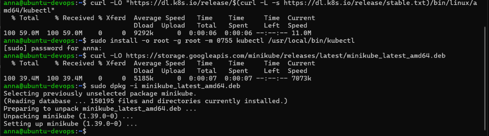

Настроили окружение и запустили `minikube`:
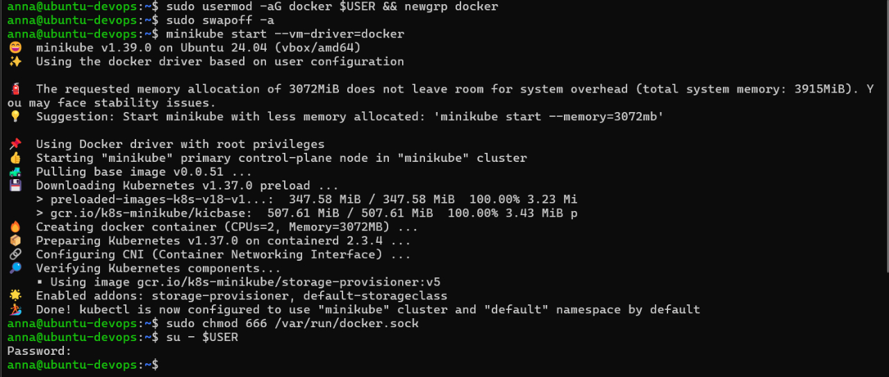

Проверили статус `minikube`, узлов и сервисов:
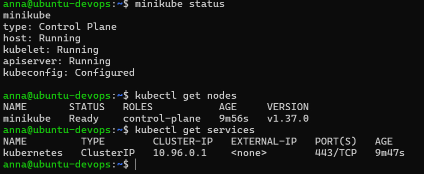

### 2. Подготовка приложения и образов для minikube

Обновили код приложения `app.py`:
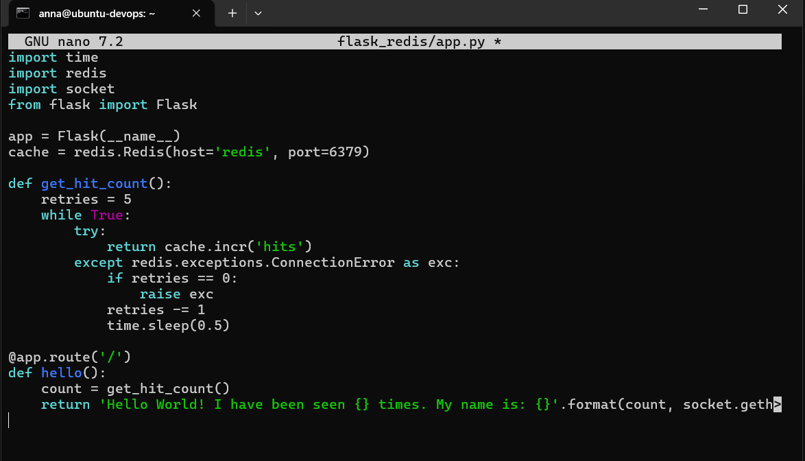

Загрузили и проверили образы в `minikube` — в списке образов кластера отображаются `redis:alpine` и `flask:v1`:
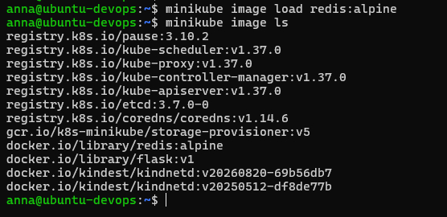

### 3. Создание манифестов Kubernetes

Создали манифест Deployment для `flask-app`:
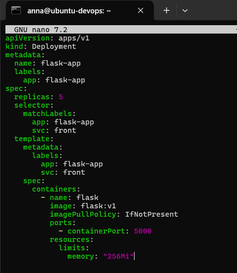

Создали манифест Service для `flask-app`:
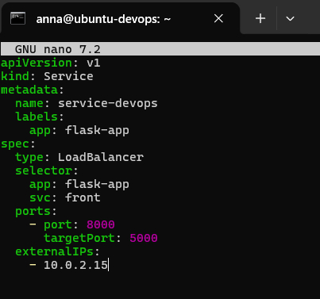

Создали манифест Deployment для `redis`:
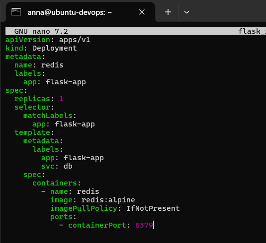

Создали манифест Service для `redis`:
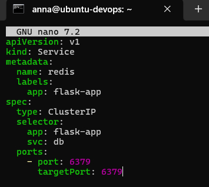

### 4. Развёртывание и проверка работы приложения

Применили манифесты и проверили поды и сервисы — созданы сервисы `service-devops` (`LoadBalancer`, `EXTERNAL-IP` `10.0.2.15`, порт `8000`) и `redis` (`ClusterIP`, `10.99.80.199`, порт `6379`), а также деплойменты `flask-app` и `redis` (под `redis` уже в статусе `Running`, поды `flask-app` создаются):
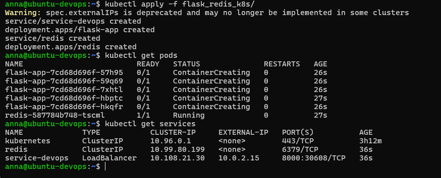

Проверили статусы подов — все 5 реплик `flask-app` и под `redis` перешли в статус `Running` (`1/1`):
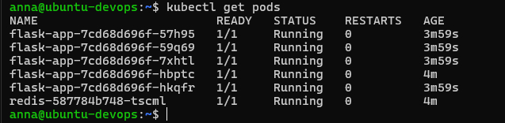

Проверили работу приложения в браузере — открыта страница по `127.0.0.1:8000`, счётчик посещений в Redis равен `35`, ответ вернул под `flask-app-7cd68d696f-hkqfr`:
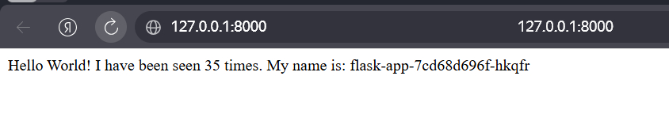

Повторно проверили работу приложения и балансировку по репликам — счётчик увеличился до `36`, запрос обработал другой под (`flask-app-7cd68d696f-7xhtl`):
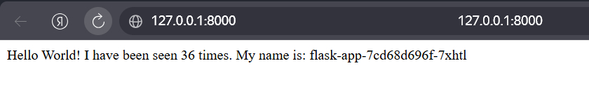

### 5. Обновление приложения до версии VERSION 5!

Обновили `app.py` до `VERSION 5!`:
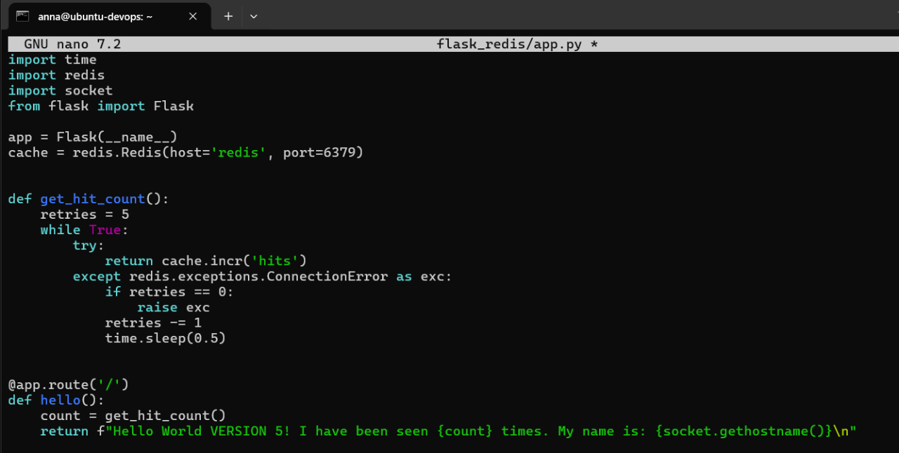

Проверили наличие образа `flask:v5` в `minikube` — в списке образов кластера появился `docker.io/library/flask:v5`:
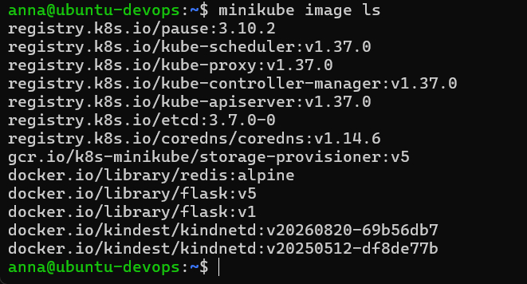

Обновили образ в Deployment и проверили статус выкатки и подов — выкатка `flask-app` завершилась успешно (`successfully rolled out`), запущены 5 новых подов `flask-app-77b769f69-*` в статусе `Running`, под `redis` продолжает работать:
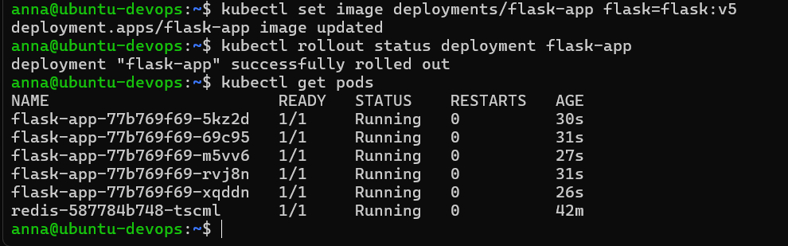

Проверили работу версии `VERSION 5!` в браузере — по `127.0.0.1:8000` отображается `Hello World VERSION 5!`, счётчик Redis равен `40`, ответ вернул под `flask-app-77b769f69-69c95`:
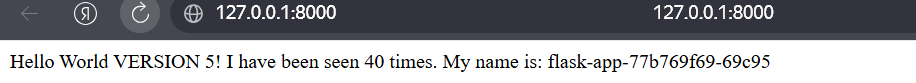

Проверили детали Deployment и ход обновления — ревизия обновлена до `2`, стратегия `RollingUpdate` (`25% max unavailable, 25% max surge`), образ `flask:v5`, 5 доступных реплик в `flask-app-77b769f69`, старый `ReplicaSet` `flask-app-7cd68d696f` масштабирован до `0` реплик:
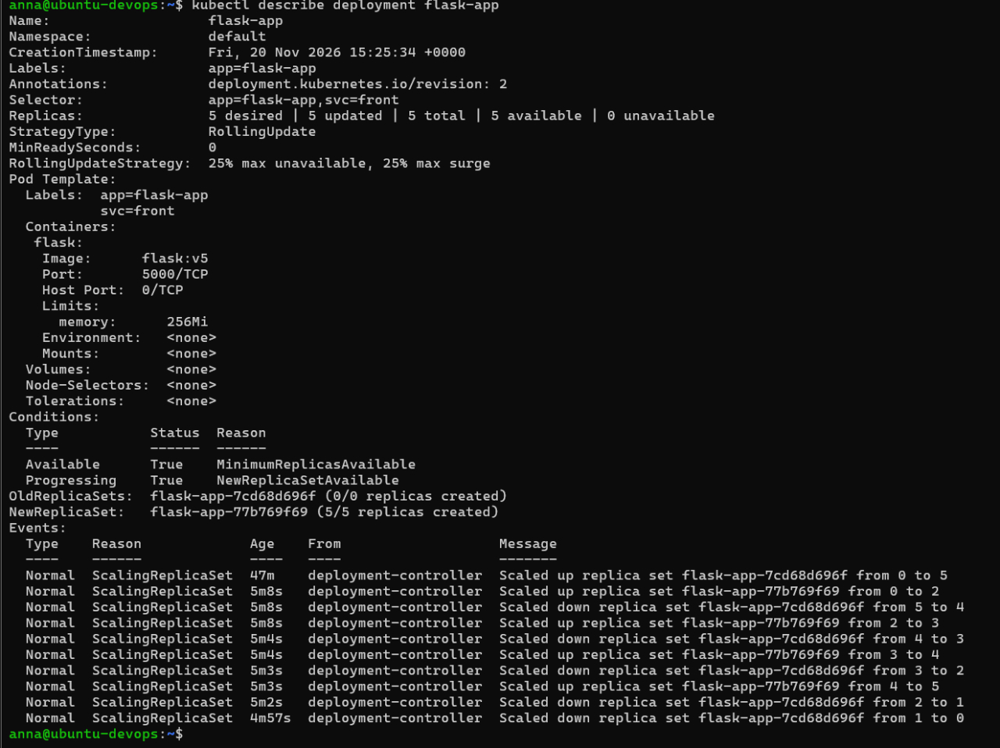